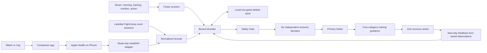

# Implemented Mobile Architecture

This describes the delivered Flutter application on `main`. The earlier [system-architecture.jpg](diagrams/system-architecture.jpg) is a design artifact: its separate smartphone Punch Test and Recovery-then-Safety arrow are no longer the implementation.

The UI is in [`lib/ui/`](../../lib/ui/); navigation and workflow state are in [`lib/app/boxer_controller.dart`](../../lib/app/boxer_controller.dart). The HealthKit reader is [`lib/data/apple_health_source.dart`](../../lib/data/apple_health_source.dart), the FightCamp sample source is [`lib/data/fightcamp_demo_source.dart`](../../lib/data/fightcamp_demo_source.dart), and the encrypted mobile store is [`lib/data/native_athlete_store_io.dart`](../../lib/data/native_athlete_store_io.dart). Safety, six-domain assessment, limiter, and training rules are in [`lib/domain/recovery_engine.dart`](../../lib/domain/recovery_engine.dart).

HealthKit is available only on a permitted iPhone installation. A device source or metric without a readable record remains unavailable. Health Connect and an official FightCamp API are future integration points. The app has no backend and no runtime AI model. The [ERD](diagrams/erd.png) is a **conceptual domain model**; the physical SQLCipher store uses `athlete_root` and `athlete_records` with encrypted JSON payloads and photo BLOBs, as described in the [README](../../README.md).
